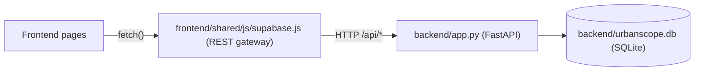
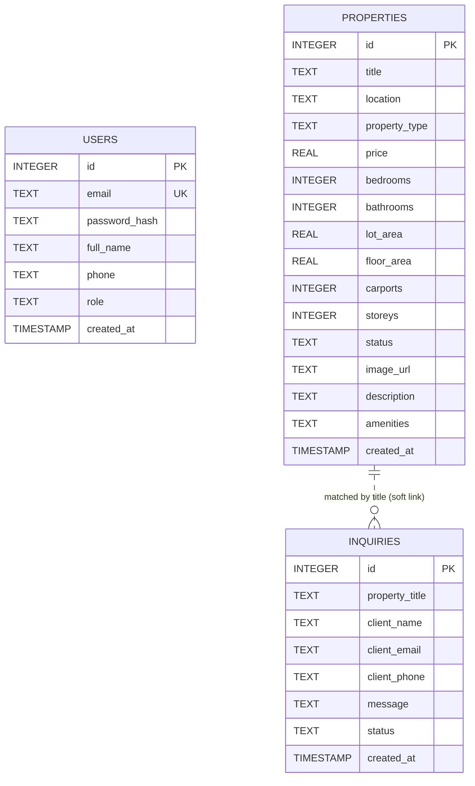

# Database — UrbanScope (CD Miranda Realty)

This document describes the data layer behind the UrbanScope platform: the
schema, seed data, how migrations work, and how the frontend reaches it.

> Source of truth: [`backend/database.py`](backend/database.py).
> If this document and the code disagree, the code wins — please update this file.

---

## 1. Overview

| Item | Value |
| :--- | :--- |
| Engine (runtime) | **SQLite 3** via Python's standard `sqlite3` module |
| File | `backend/urbanscope.db` (auto-created, **git-ignored** via `*.db`) |
| Access layer | Raw parameterised SQL in [`backend/app.py`](backend/app.py) — no ORM |
| Connection helper | `get_db_connection()` — `row_factory = sqlite3.Row`, `check_same_thread=False` |
| Schema bootstrap | `init_db()` — runs on import of `backend.app` **and** in the FastAPI lifespan hook |
| Optional cloud mirror | [`backend/supabase_schema.sql`](backend/supabase_schema.sql) (PostgreSQL / Supabase) |



> [!NOTE]
> Despite its name, `frontend/shared/js/supabase.js` does **not** talk to Supabase. It is a
> REST client for the local FastAPI backend, kept under that filename for
> backward compatibility with existing page scripts.

---

## 2. Entity Relationship

There are **no foreign keys**. Inquiries reference properties by *title text*,
not by ID, and are not linked to user accounts.



---

## 3. Tables

### 3.1 `users`

Client and admin accounts.

| Column | Type | Constraints / Default | Notes |
| :--- | :--- | :--- | :--- |
| `id` | INTEGER | PK, AUTOINCREMENT | Used as JWT `sub` claim |
| `email` | TEXT | UNIQUE, NOT NULL | Stored lower-cased on register; lookups use `LOWER(email)` |
| `password_hash` | TEXT | NOT NULL | Format `"<salt_hex>$<pbkdf2_hex>"` — see §6 |
| `full_name` | TEXT | NOT NULL | |
| `phone` | TEXT | — | Free-form; frontend validates PH formats (`+639…` / `09…`) |
| `role` | TEXT | `'user'` | `'user'` or `'admin'` |
| `created_at` | TIMESTAMP | `CURRENT_TIMESTAMP` | UTC, `YYYY-MM-DD HH:MM:SS` |

### 3.2 `properties`

Listing catalog shown on the home page, catalog, detail pages, and chatbot.

| Column | Type | Default | Notes |
| :--- | :--- | :--- | :--- |
| `id` | INTEGER | PK, AUTOINCREMENT | Used in `property-detail.html?id=…` |
| `title` | TEXT | NOT NULL | Also the join key used by `inquiries.property_title` |
| `location` | TEXT | NOT NULL | e.g. `"Manuyo, Las Piñas City"` (may contain diacritics) |
| `property_type` | TEXT | NOT NULL | Free text — see type values below |
| `price` | REAL | NOT NULL | Philippine Pesos (₱), whole amount |
| `bedrooms` | INTEGER | `3` | |
| `bathrooms` | INTEGER | `2` | |
| `lot_area` | REAL | `120` | m² |
| `floor_area` | REAL | `80` | m² — *added by migration* |
| `carports` | INTEGER | `1` | *added by migration* |
| `storeys` | INTEGER | `2` | *added by migration* |
| `status` | TEXT | `'Available'` | Free text |
| `image_url` | TEXT | — | **Root-relative** path, e.g. `assets/images/property1.jpg` (relative to `frontend/`) |
| `description` | TEXT | — | |
| `amenities` | TEXT | `''` | **Comma-separated** list — *added by migration* |
| `created_at` | TIMESTAMP | `CURRENT_TIMESTAMP` | Catalog sorts `ORDER BY created_at DESC` |

**`property_type` values in use:** `Subdivision`, `Villa`, `Condominium`,
`Townhouse`, `Triplex`. The API also understands `Single Attached`.
The `GET /api/properties?type=` filter maps UI category aliases to these values:

| UI `type` param | Matches `property_type` containing… |
| :--- | :--- |
| `villa`, `villas` | `villa` |
| `townhouse(s)` | `townhouse` |
| `apartment(s)`, `condo`, `condominium(s)` | `condominium` **or** `apartment` |
| `subdivision(s)` | `subdivision` |
| `triplex(es)` | `triplex` |
| `single attached` | `single attached` |
| `luxury`, `luxury villas` | `villa` **or** `price >= 5,000,000` |
| `house-lot`, `house & lot`, `house(s)` | townhouse / subdivision / single attached / triplex / villa |
| anything else | `LIKE %value%` |

### 3.3 `inquiries`

Client consultation / viewing requests submitted from `frontend/pages/inquiry/inquiry.html`.

| Column | Type | Default | Notes |
| :--- | :--- | :--- | :--- |
| `id` | INTEGER | PK, AUTOINCREMENT | |
| `property_title` | TEXT | — | API substitutes `"General Inquiry"` when empty |
| `client_name` | TEXT | NOT NULL | Min length 2 (Pydantic) |
| `client_email` | TEXT | NOT NULL | Not linked to `users.email` |
| `client_phone` | TEXT | — | |
| `message` | TEXT | NOT NULL | |
| `status` | TEXT | `'Under Review'` | See lifecycle below |
| `created_at` | TIMESTAMP | `CURRENT_TIMESTAMP` | |

**Status lifecycle (as used by the admin dashboard UI):**

```text
Submitted → Requirements Submitted → Under Review → Approved → Completed
```

`GET /api/stats` counts an inquiry as *pending* when `LOWER(status)` contains
`review` or `pending`.

---

## 4. Search Normalisation

`get_db_connection()` registers a custom SQL function, `NORMALIZE(text)`, backed by
`normalize_text()` in Python. It:

1. Strips diacritics (`Las Piñas` → `las pinas`, `Dasmariñas` → `dasmarinas`)
2. Replaces `-` and `_` with spaces
3. Lower-cases and trims

All property filters compare `NORMALIZE(column) LIKE '%' || NORMALIZE(?) || '%'`,
so a user typing *"las pinas"* matches *"Las Piñas City"*.

> [!IMPORTANT]
> `NORMALIZE()` only exists on connections opened via `get_db_connection()`.
> Opening the DB with a plain `sqlite3.connect()` (or the `sqlite3` CLI) and running
> API queries will fail with `no such function: NORMALIZE`.

---

## 5. Migrations

There is no migration framework. `init_db()` is **idempotent** and non-destructive:

1. `CREATE TABLE IF NOT EXISTS` for all three tables.
2. For `properties`, reads `PRAGMA table_info(properties)` and runs
   `ALTER TABLE … ADD COLUMN` for any missing column
   (`floor_area`, `carports`, `storeys`, `amenities`).

**To add a new column:**

1. Add it to the `CREATE TABLE` statement in `init_db()` (for fresh databases).
2. Add a matching `if "<col>" not in existing_cols: ALTER TABLE …` guard (for existing databases).
3. Update the Pydantic models in [`backend/models.py`](backend/models.py)
   (`*Create`, `*Update`, `*Response`).
4. Update any explicit column lists in `INSERT` statements in [`backend/app.py`](backend/app.py)
   and the seed block in `init_db()`.
5. Mirror the change in [`backend/supabase_schema.sql`](backend/supabase_schema.sql).
6. Update this document.

> [!WARNING]
> SQLite cannot drop or rename columns safely with `ALTER TABLE` in older versions,
> and the guard pattern only handles *additions*. Renames/removals require a manual
> table rebuild — or, during development, simply deleting `backend/urbanscope.db`.

---

## 6. Passwords & Tokens

Defined in [`backend/auth.py`](backend/auth.py).

- **Hashing:** PBKDF2-HMAC-SHA256, 100,000 iterations, 16-byte random hex salt.
  Stored as `salt$hash` (both hex). Verified with `hmac.compare_digest`.
- **JWT:** HS256, 7-day expiry, payload `{ sub: "<user id>", email, role, exp, iat }`.
  Secret from env var `URBANSCOPE_SECRET_KEY` (a hard-coded fallback exists for dev).
- **Client storage:** `localStorage` keys `urbanscope_jwt_token`, `urbanscope_user`,
  `urbanscope_demo_user`.

---

## 7. Seed Data

Seeding happens inside `init_db()` **only when the table is empty**, per table.

**Users**

| Email | Password | Role | Name |
| :--- | :--- | :--- | :--- |
| `admin@cdmiranda.com` | `admin123` | `admin` | Miriam Lobren (Admin) |
| `client@example.com` | `client123` | `user` | Sample Client |

**Properties (6)**

| Title | Location | Type | Price (₱) |
| :--- | :--- | :--- | ---: |
| Velemont Residences | Manuyo, Las Piñas City | Subdivision | 6,880,000 |
| Green Valley Villa | Dasmariñas, Cavite | Villa | 5,200,000 |
| Horizon Heights | Pamplona, Las Piñas City | Condominium | 3,450,000 |
| Liora Homes Executive Townhouse | Pasong Buaya II, Imus, Cavite | Townhouse | 2,400,000 |
| Airmen Triplex Modern Residence | Poblacion, Naic, Cavite | Triplex | 3,100,000 |
| Sunset Heights Executive Townhouse | Habay, Bacoor, Cavite | Townhouse | 3,800,000 |

**Inquiries (3)** — Sarah Jenkins (*Under Review*), Mark Anthony Cruz (*Approved*),
Maria Elena Santos (*Completed*).

> [!CAUTION]
> Seed credentials are for local development only. Change or remove them, and set
> `URBANSCOPE_SECRET_KEY`, before any public deployment.

---

## 8. Common Tasks

**Reset the database** (drops all data, re-seeds on next start):

```powershell
Remove-Item backend\urbanscope.db
python run.py
```

**Inspect data** (read-only queries that don't use `NORMALIZE`):

```powershell
python -c "import sqlite3; c=sqlite3.connect('backend/urbanscope.db'); print(c.execute('SELECT id,title,price FROM properties').fetchall())"
```

**Browse via API:** `http://127.0.0.1:8000/docs` (Swagger UI).

---

## 9. Supabase / PostgreSQL Mirror

[`backend/supabase_schema.sql`](backend/supabase_schema.sql) is a standalone script
that recreates the same three tables plus seed data in PostgreSQL. It is **not used
at runtime** — the app only talks to SQLite.

Differences from SQLite:

| Aspect | SQLite (runtime) | Supabase script |
| :--- | :--- | :--- |
| IDs | `INTEGER AUTOINCREMENT` | `BIGINT GENERATED BY DEFAULT AS IDENTITY` |
| Money / areas | `REAL` | `NUMERIC(15,2)` / `NUMERIC(10,2)` |
| Timestamps | `TIMESTAMP` (naive UTC text) | `TIMESTAMPTZ` (UTC) |
| Indexes | none | location, type, price, status, inquiry status, user email |
| Extensions | — | `uuid-ossp`, `unaccent` |
| Row Level Security | n/a | Enabled, but **all policies are `USING (true)`** (fully open) |
| Re-run behaviour | Non-destructive | **`DROP TABLE … CASCADE`** — wipes existing data |

> [!WARNING]
> The Supabase RLS policies allow anonymous read/write on every table, including
> `users.password_hash`. Tighten them before exposing a Supabase project publicly.

---

## 10. Known Gaps

- **No referential integrity** — `inquiries.property_title` is free text; renaming
  a property orphans its inquiries.
- **No server-side authorisation on writes** — `POST/PUT/DELETE /api/properties`
  and `GET /api/inquiries` do not check the JWT or role.
- **Admin property pages bypass the DB** — `frontend/pages/admin/properties.js` reads
  `localStorage["properties"]` and `frontend/pages/admin/add-property.js` writes
  `localStorage["urbanScopeProperties"]`; neither calls the API, and the keys differ.
- **Stats mismatch** — the dashboard UI shows 5 KPIs, but `GET /api/stats` returns only
  `total_properties`, `total_inquiries`, `pending_inquiries`.
- **No indexes** in SQLite (fine at current data volume).
